  

###

<h2 data-importer="text" align="left">Hi 👋! My name is Balkrishna Jha and I'm a Civil Engineer from Nepal</h2>

###

  
  

###

###

  
  
  
  
  
  
  
  
  
  
  
  
  
  
  
  
  
  
  

## 🌐 Socials:
     

###

 

###

Hello World!!

###

  

###

  

###
